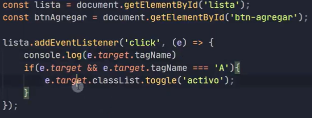

# JavaScript

Notas:

- JavaScript es sensible a mayúsculas y minúsculas
- Usa la sintaxis de tipo camelcase. getElementById
- Punto y coma al final de cada sentencia

Formas de hacer código JS:

- En el archivo HTML al final de la etiqueta body usaremos la etiqueta script.
- En el archivo HTML en la etiqueta head se usa la etiqueta script defer para que se ejecute toda la estructura y al final la etiqueta js.
- Archivos externos usando la etiqueta script con src para importarlos.

## Aprendizaje

- Introducción
    
    ### Variables
    
    - Como definir variables
        
        con la etiqueta var seguido de un identificador empezado con letras, luego = y el valor; Ejemplo: var edad = 27; otra opción es con la etiqueta let siguiendo la misma estructura y la etiqueta const.
        
        Diferencias:
        
        | var | let | const |
        | --- | --- | --- |
        | define variables globales. | define variables para bloques concretos de código. | define constantes, por lo que se usa para valores que no queremos redefinir. |
    - Tipos de variables
        - String - cadenas de texto (usar ‘’ o “”)
        - number - número
        - boolean - verdadero o falso
        - Arrays - arreglo definido con []
        - object - objetos  definido con {}
        - function - funciones se define con la etiqueta function seguido del nombre de la función y paréntesis con o sin parámetros y luego el bloque de la función.
        
        Tipo de Valor
        
        - null - valor nulo
        - undefined - valor sin definir
    - Operadores
        - Operadores normales
            
            = asignación
            
            + Suma
            
            - Resta
            
            * Multiplicación
            
            /División
            
            %Modulo
            
            ++ aumento en 1
            
            — diminuye en 1
            
        - Operadores de asignación
            
            += suma al valor de una variable
            
            -= resta al valor de una variable
            
            *= multiplica el valor de una variable
            
            /= divide el valor de una variable
            
        - Operadores de comparación
            
            < menor que
            
            > mayor que
            
            ≤ menor o igual
            
            ≥ mayor o igual
            
            == igual que (comparación de valor) ejemplo 10 == ‘10’ esto seria verdadero pq el valor es el mismo
            
            === igual que (compara valor y tipo) ejemplo 10 === ‘10’ esto es false pq no son el mismo tipo de valor, valen lo mismo pero uno es texto y el otro número.
            
            ? asignar un valor personalizado en caso de tue o false, ejemplo: 7 > 5 ? “el primer número es mayor” : “el segundo número es mayor”; la primera parte escrita después del signo ? es el true y la que va después de los : es la parte del false.
            
        - Operadores lógicos
            
            && AND
            
            || OR
            
            ! NOT
            
    - Arreglos
        
        const arreglo = ["texto", 456.4534, false, { propiedad: "valor" }, [1, 2, 3]];
        
    - Objetos
        
        ```jsx
        const persona = {
            nombre: "Carlos",
            edad: 27,
            email: "ejemplo@gmail.com",
            suscripcion: {
                web: true,
                onrop: true,
            },
            colores: ["verde","azul"],
            saludo: function () {
                alert("hola");
            },
        };
        ```
        
    - template strings
        
        console.log(` ${dentro de este campo podemos poner variables y estarian dentro del string}`);
        
    - onClick llamada de función
        
        se define una función sea como ejemplo:
        
        ```jsx
        function saludo() {
            console.log("pepe");
        }
        
        ```
        
        esta función puede ser llamada desde la pagina web atreves de un botón usando Onclick:
        
        ```html
        <button onclick="saludo()">
                perico
            </button>
        ```
        
        al clickear el botón se ejecutará la función.
        
    
    ### Clase
    
    - Class
        
        se define el nombre de la clase con la etiqueta class: class Usuario {}
        
    - Constructor
        
        método para generar el objeto de la clase, donde se definen los parámetros:
        
        constructor(nombre, apellido){
        this.nombre = nombre;
        this.apellido = apellido;
        }
        
    - Uso
        
        Para generar un objeto de clase se usa la etiqueta new seguido del nombre de la clase y agregamos los valores de los parámetros que solicita el constructor.
        
    - Herencia
        
        Al crear una clase podemos extenderla de una clase ya existente y con podemos usar los métodos y parámetros de constructor podremos extenderla con la etiqueta extends seguido del nombre de la clase padre:
        class moderador exteds usuario(){}
        
        ahora para heredar el constructor del padre, dentro del constructor de la clase donde estemos podremos usar el método super(); este método utiliza los parámetros del padre únicamente tenemos que enviarle los valores:
        super(nombre, apellido);
        
    
    ### CallBack y Promesas
    
    - Callbacks
        
        Función invocable normalmente encontrada en librerias, la funcion solicita parametro y una funcion de ejecución posterior a la ejecucíon de la función. Este tipo de funciones se llama callback, esto es para retornar información y directamente ejecutarla en la funcion que estamos enviando.
        Obtenerdatos(”255039128738”, (Informacion) ⇒ {
        ”LOGICA DE PROCESAMIENTO DE LA INFORMACIÓN RETORNADA POR LA FUNCION OBTENER DATOS”
        });
        
    - Promesas
        
        Es una función que permite dejar en navegador a la escucha con la promesa de que le retornaremos la información.
        
        const promesa = new Promise((resolve, reject) ⇒ {
        // acciónes o logica de ejecución
        resolve(”enviamos la respuesta”)
        reject(”enviamos el mensaje del pq falló el procesamiento”)
        });
        
        para ejecutar codigo adicional y mostrar el mensaje cuando se usa resolve debemos definir la .then:
        promesa.then((mensaje) ⇒ {
        // mostrar al usuario o procesar la respuesta lo importante es que este bloque se lanza cuando se usa resolve
        });
        
        para ejecutar código adicional y mostrar el mensaje cuando se usa reject debemos definir la .catch:
        misma lógica anterior para resolve solo cambia el .then por .catch
        
    
    ### Async/Await y Try/Catch
    
    - Explicación
        
        función asíncrona que permite esperar la respuesta de una promesa para ejecutar código, con await esperamos la respuesta, y para usar await debemos definir la funcion como async. esto unicamente captura la respuesta de exito para capturar la respuesta de error se debe trabajar con el bloque try y catch.
        
        const mostrar = async() ⇒{
        try{
        const respuesta = await ObtenerDatos();
        //procesamos la respuesta o la imprimirmos
        }catch (error){
        console.log(error)
        //Este bloque de codigo se ejecuta cuando se captura el error interrumpiendo el bloque try y ejecutando el bloque catch.
        };
        }:
        
- Rollup Modules
    - Descargas
        
        Para usar rollup se necesita descargar NodeJS.
        Ya con Node.js en la carpeta de nuestro proyecto ejecutamos npm init -y para generar los archivos de package.json e instalar las dependencias.
        ya con los archivos de dependencias procedemos a instalar rollup (revisar documentación) se puede instalar de forma global o de forma local.
        INSTALACIÓN LOCAL: npm install rollup —save-dev
        
    - Configuración
        
        Crear archivo rollup.config.mjs y poner::
        
        ```jsx
        export default { 
          input: "./src/index.js", ubicación del archivo de entrada
          output: {
            file: "./public/bundle.js", ubicación de archivo de salida
            format: "cjs",
          },
        };
        ```
        
        creamos el script de ejecución en package.json para compilar los importes en el archivo de salida:
        
        ```json
        "scripts": {
            "test": "echo \"Error: no test specified\" && exit 1",
            "build": "rollup --config --watch" script agregado para la actualización
          },
        ```
        
        y en la terminal (obviamente en la ubicación del proyecto) ejecutamos npm run build.
        
        Importante:
        
        ```json
        "type": "module",
          "name": "tienda",
          "version": "1.0.0",
          "description": "",
          "main": "index.js",
        ```
        
        cambiar el main a index.js y cambiar el type a module.
        
    - Imports y Exports
        - Export nameSpace y named
            
            La forma de exportar no es diferente para estos 2.
            
            ```jsx
            // nameSpace
            export const funSumar = (num1, num2) => {
              console.log(`Sumando ${num1} + ${num2} = ${num1 + num2}`);
            };
            
            export const sumar = "suma";
            ```
            
            ```jsx
            // named
            export const calcularFactorial = () => {
              console.log("Factorial calculado");
            };
            
            export const nombre = "pedro";
            ```
            
        - Import nameSpace
            
            ```jsx
            // nameSpaceImports
            import * as operaciones from "./nameSpaceExports";
            console.log(operaciones.sumar);
            operaciones.funSumar(12, 13);
            
            ```
            
        - Import named
            
            ```jsx
            // namedImport
            import { nombre, calcularFactorial } from "./namedExports";
            console.log(`El nombre del cliente es ${nombre}`);
            calcularFactorial();
            ```
            
        - Import y Export default
            
            La forma de exportar es para tener una unica función para exportar.
            
            ```jsx
            export default () => {
              return {
                nombre: "Juan",
                edad: 27,
              };
            };
            ```
            
            Al momento de importar podemos ponerle el nombre que queramos.
            
            ```jsx
            // defaultImports
            import usuario from "./defaultExports";
            console.log(usuario());
            ```
            
        - Import y Export Empty
            
            Esto permite cargar el funcionamiento de un archivo .js sin cargar objetos a la archivo donde se importa.
            
            ```jsx
            // empty
            //logica de funcionamiento
            console.log("Estamos ejecutando");
            ```
            
            y se importa sin señalar un objeto, unicamente el archivo.
            
            ```jsx
            // emptyImports
            import "./emptyExports";
            ```
            
- BOM
    - .open()
        
        BOM siendo Browser Object Model es un objeto que nos permite usar funciones sobre la venta de la aplicación o sobre el mismo navegador. Ese objeto siento “window”
        
        uno de los ejemplos más comunes:
        
        ```jsx
        const abrir = () => {
            window.open("file:///C:/Users/Juan2/OneDrive/Escritorio/ProyectosCursos/ProyectosJavascript/Teoria/modulos/public/index.html",
                "Mi Nueva Ventana", 
                "height=800px,width= 800px"); 
        };
        ```
        
        En este ejemplo se usa la función .open() este método puede recibir 3 parámetros los cuales son: 
        1.- URL de la web que se desea abrir
        2.- Nombre de la ventana
        3.- parámetros HTML que queramos agregar, revisar docimentación [link](https://developer.mozilla.org/es/docs/Web/API/Window/open#position_and_size_features).
        
    - .document.write()
        
        ```jsx
        ventana.document.write("<h1>Hola Mundo</h1>"); 
        ```
        
        con este método podemos ejecutar HTML dentro de la ventana, logrando vistas dinamicas.
        
    - .close()
        
        la variable que almacena la ventana se le aplica el método .close(), cerrando la ventana.
        
        ```jsx
        const cerrar = () => {
            ventana.close();
        };
        ```
        
    - Objeto Screen
        
        ```jsx
        // screen object
        const ancho = window.screen.width;
        const alto = window.screen.height;
        console.log(`El ancho de la pantalla es: ${ancho}`);
        console.log(`El alto de la pantalla es: ${alto}`);
        ```
        
        Esto nos permite conoces el tamaño real de la pantalla del usuario.
        
        ```jsx
        console.log(`El ancho de la ventana es: ${window.screen.availWidth}`);
        console.log(`El alto de la ventana es: ${window.screen.availHeight}`);
        ```
        
        Espacio de la pantalla descontando lo que ocupe la barra de navegación.
        
    - .innerWidth y innerHeight
        
        ```jsx
        console.log(`El ancho de la ventana es: ${window.innerWidth}`);
        console.log(`El alto de la ventana es: ${window.innerHeight}`);
        ```
        
        Nos permite conocer el tamaño actual de la ventana de navegación.
        
    - Location y History
        
        ```jsx
        // location 
        console.log(window.location);
        console.log(window.location.href);
        ```
        
        el atributo location contiene información sobre la ubicación en la web de nuestra pagina.
        el href contiene la URL directa de nuesta paginación actual en la web.
        
        Location es un objetoq ue contiene información  extensa de la ubicación de la pagina.
        
        ```jsx
        const back = () => {
            window.history.back();
        }
        const forward = () => {
            window.history.forward();
        }
        ```
        
        el atributo history permite navegar entre el historial de la pagina ya sea retroceder o avanzar.
        
    - navigator
        
        Con este atributo de window podemos buscar información del navegador y sus cookies.
        
        ```jsx
        console.log(navigator.cookieEnabled);
        console.log(navigator.language);
        console.log(navigator.userAgent);
        console.log(navigator.onLine);
        ```
        
    - Alerts
        
        ```jsx
        alert("Aviso importante")
        confirm("Desea continuar?")
        prompt("Digite su nombre:")
        ```
        
        Alert solo muestra un aviso en pantalla con un boton y ya.
        
        confirm tiene 2 botones para confirmar y para rechazar
        
        prompt tiene un input de texto que podemos guardar en una variable.
        
    - timers
        - setTimeout y clearTimeout
            
            ```jsx
            id = setTimeout(llamarTiempo, 5000);
            clearTimeout(id);
            ```
            
            la función setTimeout nos permite poner un temporizador antes de ejecutar una función o un bloque de código , durante el tiempo de espera podemos limpiar el temporizador para detener el proceso de espero y no ejecutar el bloque de código. Esto lo podemos lograr con clearTimeout. 
            
        - setInterval
            
            ```jsx
            setInterval(() => {
                console.log("Han pasado 1000 ms");
            }, 1000);
            ```
            
            setInterval ejecuta el bloque de codigo contenido de forma repetida cada que termina el temporizador , lo podemos detener con la función clearTimeiot.
            
    - cookies
        
        ```jsx
        const crearCookie = () => {
            document.cookie = "nombre = carlos; expires = 17 Oct 2026 07:10:00 UTC";
        };
        ```
        
        document.cookie nos permite interactuar con las cookies del navegador, al usarlo asi, podremos tomár las cookies existentes, al poner = “variable = valor; expires = “fecha de expiración” insertaremos una cookie en el navegador.
        
- DOM
    - Introducción, Añadir y Eliminar Elementos del DOM
        
        Introducción
        
        - Introducción al DOM
            - getElementById ByClassName y ByTag
                
                ```jsx
                const objetoById = document.getElementById("contenedor1");
                console.log(objetoById); 
                console.log(objetoById.children);
                console.log(objetoById.parentElement);
                
                const objetoByClass = document.getElementsByClassName("contenedor2");
                const objetoByTag = document.getElementsByTagName("div");
                ```
                
                tenemos varias formas de identificar objetos dentro del DOM la primero es con el ID asignado al objeto, buscando de esta forma el objeto que queramos. existen otras 2 por clase y por etiqueta.
                Retorna listasHTML no iterables en for o algun ciclo logico.
                
            - querySelector
                
                ```jsx
                const objetoByQuerySelector = document.querySelector("#contenedor1 .caja");
                const objetoByQuerySelectorAll = document.querySelectorAll("#contenedor1 .caja");
                
                console.log(objetoByQuerySelector);
                console.log(objetoByQuerySelectorAll);
                ```
                
                El querySelectorAll nos retorna una lista de nodos la cual si podemos trabajar con ciclos lógicos como si de un arreglo se tratase. 
                
                estructura: document.querySelectorAll(#”identificador ccs padre” .”identificador css hijo”);
                
            - closest
                
                ```jsx
                console.log(objetoByQuerySelectorAll[2].closest(".contenedor-principal"));
                ```
                
                Teniendo una referencia hija, podremos buscar las referencias padre con el elemento closest indicando dentro el padre que buscamos.
                
            - innerHTML
                
                ```jsx
                const caja = document.querySelector('.caja');
                console.log(caja.innerHTML);
                caja.innerHTML = 'Hola Mundo';
                ```
                
                innerHTML nos permite obtener el contenido del elemento seleccionado, al acceder al contenido podemos modificarlo. 
                
            - attribute
                
                ```jsx
                caja.id = 'caja1';
                caja.className = 'caja-modificada';
                ```
                
                ese formato nos permite cambiar atributos del objeto especificado, en el ejemplo cambiamos el atributo ID y el atributo CLASS en caso de que el atributo no exista lo creará.
                
            - setAttribute
                
                ```jsx
                caja.setAttribute('data-nuevo-atributo', 'valor');
                console.log(caja);
                ```
                
                con setAttibute podemos  crear atributos adicionales y simplemente ser más especificos con lo atributos existentes.
                
            - style.property
                
                ```jsx
                const caja2 = document.querySelector('#contenedor2 .caja');
                caja2.style.color = 'white';
                caja2.style.backgroundColor = 'blue';
                caja2.style.fontSize = '20px';
                caja2.style.padding = '10px';
                caja2.style.textTransform = 'uppercase';
                ```
                
                con esto podremos modificar propiedades css o añadir las mismas, tenemos que ser concientes de como se llaman las propiedades (conocimiento css) y que valor llevan, cuando la propiedad tenga un - entre su nomenclatura debemos cambiarla por nomenclatura camencase ejemplo: text-transform (css) a textTransform (js).
        
        Añadir al DOM
        
        - Añadir Elementos al DOM
            
            Se deben seguir los siguientes pasos:
            
            - 1.- Crear Elemento (createElement)
                
                ```jsx
                const newCaja = document.createElement("div");
                ```
                
                solo debemos definir el tag del elemento que queremos crear y almacenarlo en una variable.
                
            - 2.- Agregar contenido y atributos
                
                Con el objeto creado y almacenado usaremos lo aprendido en la introducción al DOM
                
                ```jsx
                newCaja.innerHTML = "nueva caja";
                    newCaja.setAttribute("id", "nuevaCaja");
                    newCaja.setAttribute("class", "caja activa");
                ```
                
            - 3.- Agregar al DOM
                
                para agregar al DOM tambien existen un procedimiento, primero debemos seleccionar el objeto donde insertaremos el nuevo Elemento.
                
                ```jsx
                const contenedor = document.querySelector("#contenedor1");
                ```
                
                ya seleccionado existen varias formas de insertar al dom:
                
                - appendChild(”Elemento”)
                    
                    imaginando que el contenedor tiene una cola  de hijos con appendChild añadimos un hijo a la cola (al final)
                    
                    ```jsx
                    const contenedor = document.querySelector("#contenedor1");
                    contenedor.appendChild(newCaja); // Agrega al final del contenedor
                    ```
                    
                - insertAdjacentElement(”Ubicación”,”Elemento”)
                    
                    con esta función tendremos 4 ubicaciones donde isnertar elementos:
                    
                    aferbegin, Se agrega como primer elemento 
                    beaforebegin, Se agrega antes del contenedor padre
                    beforeend, Se agregar como ultimo elemento
                    afterend, Se agrega después del padre
                    
                    ```jsx
                    contenedor.insertAdjacentElement("afterbegin", newCaja); // Agrega al inicio del contenedor
                    contenedor.insertAdjacentElement("beforeend", newCaja); // Agrega al final del contenedor
                    ```
                    
                - insertBefore(”nuevoElemento”, “ElementoExistente”)
                    
                    ```jsx
                    const cajaExistente = document.querySelectorAll("#contenedor1 .caja");
                        //cajaExistente.replaceWith(newCaja); // Reemplaza la caja existente con la nueva caja
                    contenedor.insertBefore(newCaja, cajaExistente[2]); // Agrega al inicio del contenedor
                    ```
                    
                    buscamos el objeto de referencia y el nuevo objeto se inserta antes del objeto de referencia.
                    
                - replaceWith(”Elemento”)
                    
                    ```jsx
                    const cajaExistente = document.querySelector("#contenedor1 .caja");
                    cajaExistente.replaceWith(newCaja); // Reemplaza la caja existente con la nueva caja
                    ```
                    
                    Buscamos el elemento que queremos remplazar con el nuevo elemento, y con replaceWith lo remplazamos.
        
        Eliminar del DOM
        
        - Eliminar Elementos del DOM
            
            Debemos ubicar al elemento padre, ubicar al hijo y usar la función .removeChild.
            
            ```jsx
            const eliminarCaja = () => {
                const contenedor = document.querySelector("#contenedor1");
                const cajaAEliminar = contenedor.querySelector(".caja");
            
                contenedor.removeChild(cajaAEliminar);
            };
            ```
        		
        
    - Modificación de Clases y Estilos
        - Clases
            - classList
                
                Función que nos permite listar las clases de un elemeto.
                
                ```jsx
                const lista = elemento.classList;
                console.log("Lista de clases del elemento:", lista);
                ```
                
                devolviendo algo como: 
                
                1. *DOMTokenList(2) ['caja', 'activa', value: 'caja activa']*
                    1. **0**: "caja"
                    2. **1**: "activa"
                    3. length: 2
                    4. value: "caja activa"
            - .add(”clase que queremos añadir”)
                
                Añade una clase al Elemento indicado.
                
                ```jsx
                const activarClase = () => {
                    const elemento = document.querySelector(".caja");
                    elemento.classList.add("activa");
                };
                ```
                
            - .remove(”clase existente”)
                
                Quita la calse especificada del Elemento indicado.
                
                ```jsx
                const eliminarClase = () => {
                    const elemento = document.querySelector(".caja");
                    elemento.classList.remove("activa");
                };
                ```
                
            - .toggle(”clase”)
                
                Combina el .add y el .remove.
                
                ```jsx
                const toggleClase = () => {
                    const elemento = document.querySelector(".caja");
                    elemento.classList.toggle("activa");
                };
                ```
                
            - contains(”clase”)
                
                Revisa si eiste una clase en el classList.
                
                ```jsx
                const containsClase = () => {
                    const elemento = document.querySelector(".caja");
                    if (elemento.classList.contains("activa")) {
                        console.log("La clase 'activa' está presente en el elemento.");
                    }else {
                        console.log("La clase 'activa' NO está presente en el elemento.");
                    }
                };
                ```
                
        - Estilos
            
            para modificar los estilos CSS debemos seleccionar el elemento o los elementos. y con la función .style podremos acceder a todas las propiedades de css que conocemos y se pueden interaccuar con ellas. un ejemplo es elemento.style.color(”#ffff”); cambiando el color de la letra a blanco. con la misma estructura se pueden cambiar los estilos de css.
            
            ```jsx
            const elementos = document.querySelectorAll('.caja');
            
            elementos.forEach(elemento => {
                elemento.style.backgroundColor = 'lightblue';
                elemento.style.border = '2px solid #ccc';
            });
            ```
            
    - Eventos
        - addEventListener
            
            ```jsx
            const boton1 = document.getElementById("boton1");
            boton1.addEventListener("click", (e) => {
                const elemento = document.querySelector(".caja");
                elemento.classList.toggle("activa");
            });
            
            ```
            
            seleccionamos el elemento y le añadimos el evento, al definir el eventListener debemos poner que es lo que escuchará o el evento que estará esperando 
            
            para más información sobre los eventos: [lista de eventos](https://developer.mozilla.org/en-US/docs/Web/API/Document_Object_Model/Events#event_listing)
            
        - Propagación de eventos
            
            Esto sucede cuanto un elemento padre tiene un evento y un elemento hijo tiene un evento. al lanzar el evento del hijo tambien se ejecutará el evento propagado del padre. Para detener la propagación debemos poner en el evento hijo la siguiente linea de código: 
            
            ```jsx
            boton1.addEventListener("click", (e) => {
                e.stopPropagation(); // con esto detendremos la propagación.
                const elemento = document.querySelector(".caja");
                elemento.classList.toggle("activa");
            });
            
            ```
            
        - removeEventListener
            
            ```jsx
            const boton1 = document.getElementById("boton1");
            const evento = () => {
                const elemento = document.querySelector(".caja");
                elemento.classList.toggle("activa");
            }
            boton1.removeEventListener("click", evento);
            ```
            
            debemos tomar el elemento, usar el remove y en los parametro del remove especificar el evento y la función que se va a eliminar del DOM.
            
        - Delegación de eventos
            
            Esta logica es aprovechar la propagación de eventos para ejecutar un eevento en todos los hijos de un padre. 
            
            el padre tendrá el array de sus hijos, aprovecharemos la función target para ubiccar el elemento que esta siendo afectado por el evento y ejecutaremos lo que queramos sobre el.
            
            
            
- Api Insersection Observer
    
    
    
    Se instancia un objeto observador, como parámetros son la función a ejecutar y  las especificaciones del observador.
    
    ROOT: ubicación donde trabajara el observer al usar NULL estamos diciendo que trabaja en toda la ventana.
    
    ROOTMARGIN: al heredar el tamaño del root podremos agregarle márgenes para tener una “bandera” que nos avise que yá llegó el objeto que estamos observando.
    
    THRESHOLD: es el porcentaje del objeto que estará dentro del observador cuando que ramos lanzar la función.
    
    ya por ultimo para observar un elemento se debe seleccionar el elemento HTML y usar la función observe.
    
    
    
    